<p align="center">
  <picture><source media="(prefers-color-scheme: dark)" srcset="assets/profile-hero-dark.svg"></picture>
</p>

<p align="center">
  <a href="https://github.com/TahaSaiyed08?tab=repositories"><picture><source media="(prefers-color-scheme: dark)" srcset="assets/button-github-dark.svg"></picture></a>
  &nbsp;
  <a href="https://www.linkedin.com/in/taha-saiyed/"><picture><source media="(prefers-color-scheme: dark)" srcset="assets/button-linkedin-dark.svg"></picture></a>
</p>

<p align="center">
  <a href="#-right-now">Current focus</a> ·
  <a href="#-featured-projects">Featured projects</a> ·
  <a href="#-tech-stack">Tech stack</a> ·
  <a href="#-experience">Experience</a>
</p>

---

```ts
const taha = {
  location:  "Vancouver, BC",
  studying:  "Post-Bacc Diploma, Computer & Information Systems @ Douglas College",
  previously: "BCA @ Swarrnim University",
  builds:    ["full-stack web apps", "Android apps", "REST APIs"],
  caresAbout: ["privacy", "clean data models", "apps that do one job well"],
  lookingFor: "co-op / internship: software, QA, data or IT support",
  offline:   ["Pump Peak", "Evans Peak", "kayaking around Bowen Island"],
};
```

I like turning tedious admin, like tracking job applications or remembering when documents expire, into small, fast tools that don't ask for more of your data than they need. When I'm not shipping code or I'm usually on a trail somewhere in BC.

### 🔭 Right now

<p align="center">
  <picture><source media="(prefers-color-scheme: dark)" srcset="assets/currently-telemetry-dark.svg"></picture>
</p>

- Building **[LifeOS](https://github.com/TahaSaiyed08/lifeos)**, adding its AI scanning pipeline
- Looking for a **co-op or internship** for my program
- Learning Docker, GitHub Actions and AWS

<picture><source media="(prefers-color-scheme: dark)" srcset="assets/section-divider-dark.svg"></picture>

### 🚀 Featured projects

<table>
  <tr>
    <td width="50%"><a href="https://github.com/TahaSaiyed08/soma18-showcase"><picture><source media="(prefers-color-scheme: dark)" srcset="assets/card-soma18-dark.svg"></picture></a></td>
    <td width="50%"><a href="https://github.com/TahaSaiyed08/lifeos"><picture><source media="(prefers-color-scheme: dark)" srcset="assets/card-lifeos-dark.svg"></picture></a></td>
  </tr>
  <tr>
    <td width="50%"><a href="https://github.com/TahaSaiyed08/tersa"><picture><source media="(prefers-color-scheme: dark)" srcset="assets/card-tersa-dark.svg"></picture></a></td>
    <td width="50%"><a href="https://github.com/TahaSaiyed08/Savy"><picture><source media="(prefers-color-scheme: dark)" srcset="assets/card-savy-dark.svg"></picture></a></td>
  </tr>
</table>

**[Soma18](https://github.com/TahaSaiyed08/soma18-showcase):** I built and maintain the website, hosting and online store for Soma18. Live at [soma18.ca](https://soma18.ca).

<table>
  <tr>
    <td width="50%" valign="top">
      <h4><a href="https://github.com/TahaSaiyed08/lifeos">🗂️ LifeOS</a></h4>
      <p>Tracks subscriptions, insurance policies and document expiry dates, and warns you before they become a problem.</p>
      <ul>
        <li>In-browser document scanner (pdf.js + OCR): sensitive files never leave your machine</li>
        <li>Read-only Gmail scan that keeps the facts it needs and discards the email</li>
        <li>Per-user data isolation with Postgres row-level security</li>
      </ul>
      <p><sub>Next.js · TypeScript · Supabase · Prisma</sub></p>
    </td>
    <td width="50%" valign="top">
      <h4><a href="https://github.com/TahaSaiyed08/ApplyFlow">📋 ApplyFlow</a></h4>
      <p>Android app for tracking job applications from "applied" to "offer", with interview and follow-up reminders.</p>
      <ul>
        <li>Works fully offline on a local Room database</li>
        <li>Scheduled reminders with WorkManager</li>
        <li>Stats by status and month, plus CSV export</li>
      </ul>
      <p><sub>Java · Android · SQLite (Room)</sub></p>
    </td>
  </tr>
  <tr>
    <td width="50%" valign="top">
      <h4>🏥 Home Care Management Database</h4>
      <p>Scheduling and caregiver-assignment system for a home care service.</p>
      <ul>
        <li>Led a 4-person team designing normalized MySQL tables</li>
        <li>Node.js API with role-based access for patients, caregivers and admins</li>
        <li>Finished two weeks early, scored 98%</li>
      </ul>
      <p><sub>MySQL · Node.js</sub></p>
    </td>
    <td width="50%" valign="top">
      <h4>🏆 Vision2Reality Hackathon: 3rd place</h4>
      <p>Led a team of 4 building a growth plan for the startup SOMA18.</p>
      <ul>
        <li>Designed the startup's landing page</li>
        <li>Wrote 100 days of content scripts</li>
      </ul>
    </td>
  </tr>
</table>

<picture><source media="(prefers-color-scheme: dark)" srcset="assets/section-divider-dark.svg"></picture>

### 🛠️ Tech stack

<p align="center">
  <picture><source media="(prefers-color-scheme: dark)" srcset="assets/skills-matrix-dark.svg"></picture>
</p>

<details>
<summary>Text version</summary>

| | |
|---|---|
| **Languages** | JavaScript (ES6+), TypeScript, Java, SQL, C/C++ |
| **Frontend** | React, Next.js 14 (App Router), Tailwind CSS, TanStack Query |
| **Backend** | Node.js, Spring Boot, REST APIs, Prisma, JPA/Hibernate |
| **Data & cloud** | PostgreSQL, MySQL, MongoDB, Supabase, Vercel |

</details>

---

### 💼 Experience

**IT Support & Web Development Intern** · Kipling Media, Vancouver
- Built and maintained 5+ client websites in React and WordPress
- Sped up web app reports by rewriting slow SQL queries and adding indexes

**Web Development Intern** · Web Nodes, Ahmedabad
- Built responsive frontend components for a hospital management platform

---

### ⚡ Recent activity

<!--START_SECTION:activity-->
1. 🎉 Merged PR [#30](https://github.com/krish-arora-88/SurRealDeal/pull/30) in [krish-arora-88/SurRealDeal](https://github.com/krish-arora-88/SurRealDeal)
2. 💪 Opened PR [#30](https://github.com/krish-arora-88/SurRealDeal/pull/30) in [krish-arora-88/SurRealDeal](https://github.com/krish-arora-88/SurRealDeal)
<!--END_SECTION:activity-->

<sub>Updated automatically every 6 hours by a GitHub Action.</sub>

---

### 🤝 Let’s connect

I’m open to co-op and internship opportunities in software development, QA, data, and IT support.

<p>
  <a href="https://www.linkedin.com/in/taha-saiyed/">Connect on LinkedIn</a> ·
  <a href="https://github.com/TahaSaiyed08?tab=repositories">Browse my repositories</a>
</p>
